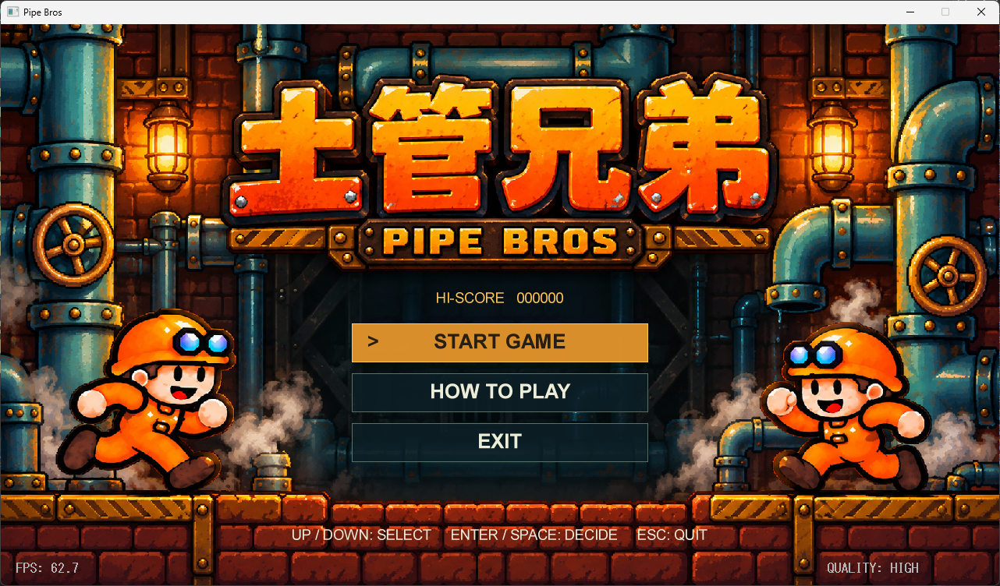
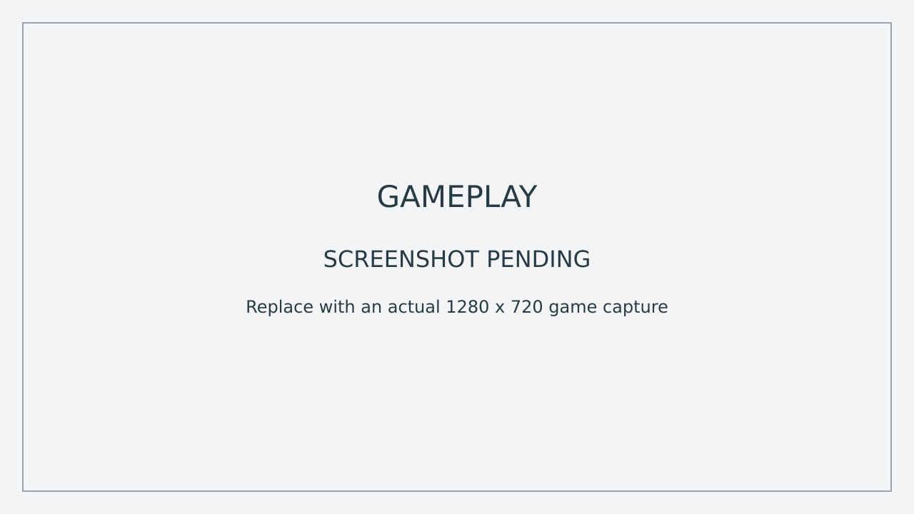
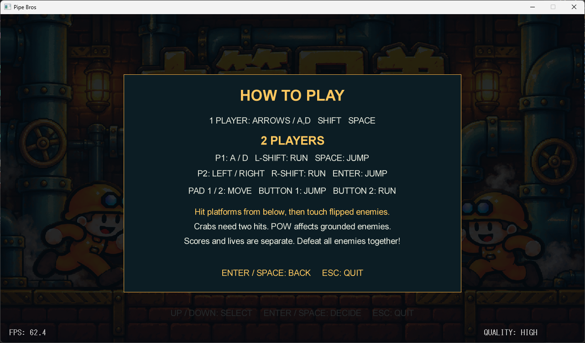
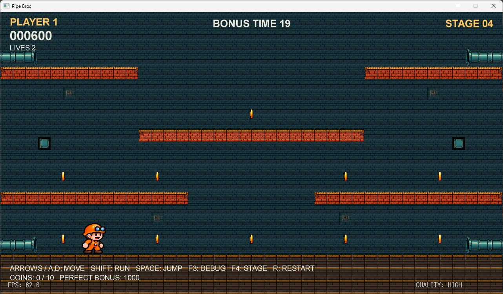
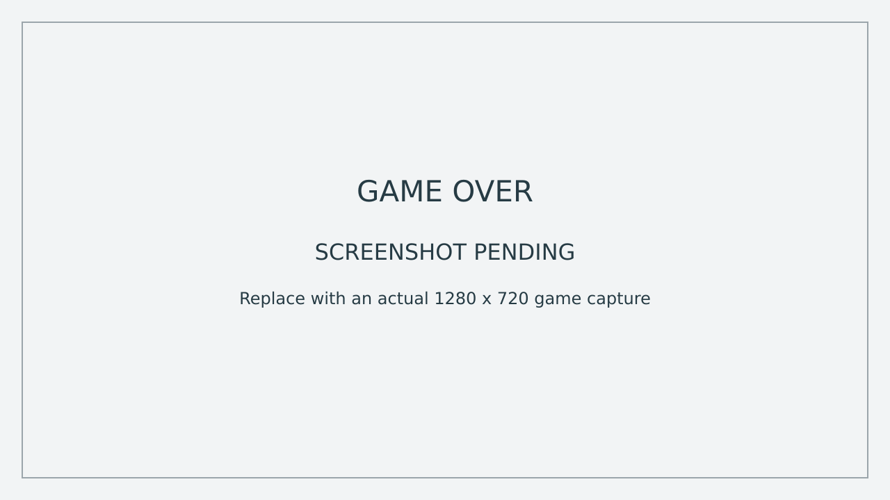
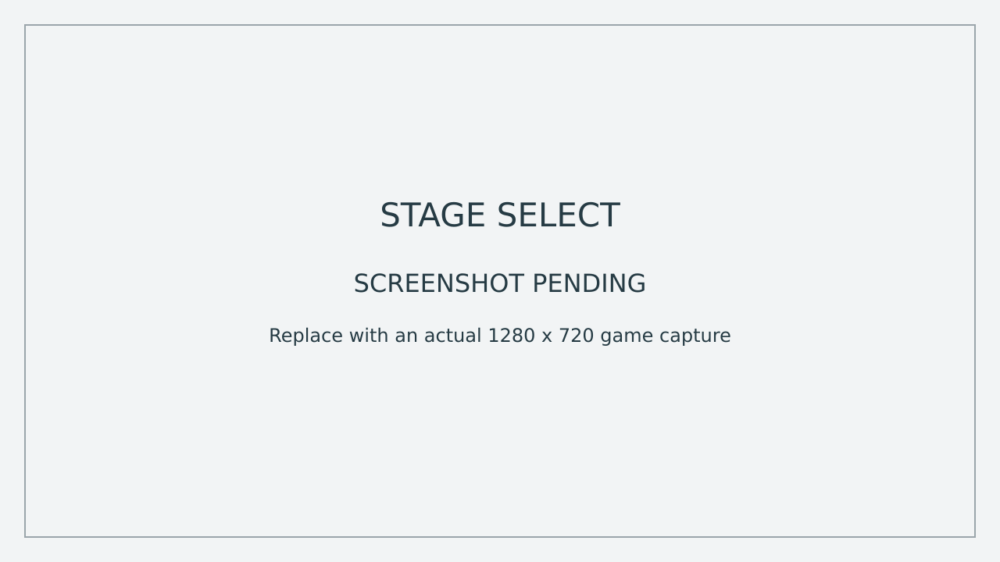
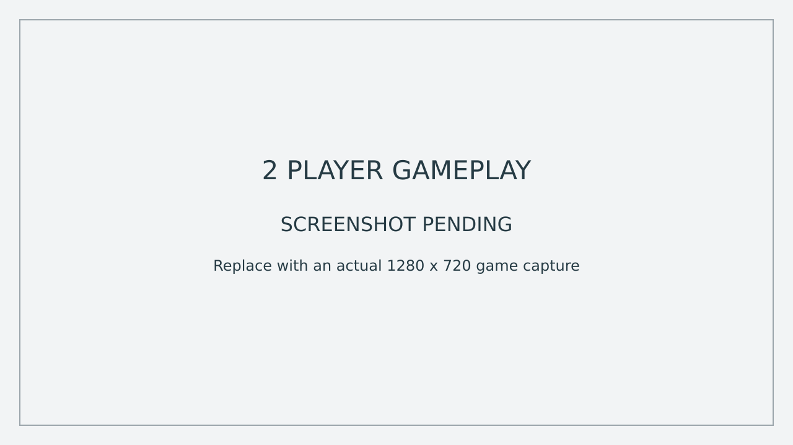

# 土管兄弟 PipeBros

足場を下から叩いて敵をひっくり返し、同じ段へ移動して蹴り飛ばす、固定画面の2Dアクションゲームです。専門学校の学生向けに、企画とC++ / DxLibの実装を対応させる参考作品として制作しています。

**更新日：2026-10-23**。1人・2人同時プレイ、押し合い・突き上げ・頭上着地、カメ・カニ、POW、ボーナス、リザルト、デバッグ用ステージ選択まで実装しています。

- [詳細仕様 GDD v1.3](docs/GDD.md)
- [授業共有用 GDD v1.3 Word版](docs/PipeBros_GDD_v1.3.docx)
- [スクリーンショットの追加方法](docs/images/screenshots/README.md)
- 開発ベース：[Endless Jump Runner](https://github.com/kaz550/gaweek-week05-EndlessJumpRunner)

## スクリーンショット

未撮影の枠は差し替え用の仮画像です。実際のゲーム画面ではありません。`docs/images/screenshots/` の同名PNGを実際のキャプチャへ置き換えると、この欄にそのまま表示されます。

| タイトル | 通常プレイ |
| --- | --- |
|  |  |

| 操作説明 | ボーナスステージ |
| --- | --- |
|  |  |

| ゲームオーバーのリザルト | デバッグ用ステージ選択 |
| --- | --- |
|  |  |

撮影は1280×720pxのPNGを推奨します。画像を差し替えたら、この「仮画像」の説明と画像の代替テキストも更新してください。

## 遊び方

1. 敵がいる足場を下からジャンプで叩きます。カメは1回で転倒、カニは1回目で怒って加速し、2回目で転倒します。
2. 転倒中・復帰中の敵に触れると蹴り飛ばし、1体100点を獲得します。
3. 下段中央のPOWは、接地中の敵全体へ1回分の衝撃を与えます。3回使うと消えます。
4. 通常ステージは敵をすべて倒すとクリア。得点・残機を引き継いで次へ進みます。

歩行中・怒り中の敵に触れると残機が1つ減ります。残機があれば1秒待って復活し、そこから2秒間は無敵です。1人時は残機0、2人時は両者の残機0でゲームオーバーとなります。

## 2人同時プレイ

タイトルの **2 PLAYERS** で開始します。1Pは橙色で左下、2Pは水色で右下から登場。得点・残機・復活待ち・無敵は個別、敵・足場・POW・コイン・ステージ進行は共有です。

- 蹴った側に100点。もう一方が転倒させた敵も蹴れます。
- 横から押し合い、下からジャンプで相手を斜め上へ飛ばせます。
- 頭の上に乗ってジャンプで離れられます。
- 接触そのものでは残機は減らず、押された後の敵との接触は通常どおり判定します。
- 復活待ち・残機0・復活したフレームは接触対象外。無敵中は押し合えます。
- 片方が残機0ならOUTとなり、残る側で続行。次ステージでもOUTを維持します。
- RETRYとRは人数を保ち、全員を得点0・残機3へ戻します。

同じ敵を同時に蹴った場合は中心が近い側、コインは移動区間で先に到達した側へ1回だけ加点します。完全同条件なら1P優先。画面端とボーナスでも接触は有効です。

## ステージとボーナス

| ステージ | 構成 | 制限時間 |
| --- | --- | --- |
| 01 | カメ2体 | なし |
| 02 | カニ2体 | なし |
| 03 | カメとカニ各1体 | なし |
| 04 | コイン回収ボーナス | 20秒 |

05以降もこの4構成を繰り返します。地形は共通の `stage01.tmx` を使用し、最終ステージは未設定です。

ボーナスには敵とPOWが出現しません。コインは取った側に1枚100点。既定の10枚を全回収すると、残機のある参加者それぞれに追加1000点。1人時の満点は2000点、2人とも残っていれば2人分の合計は3000点です。全回収または時間切れで次の通常ステージへ進みます。時間切れでも残機は減らず、取った分の得点を引き継ぎます。

## 操作

| 担当 | 左右移動 | ジャンプ | 走る | パッド |
| --- | --- | --- | --- | --- |
| 1人プレイ | ← / → またはA / D | Space | 左・右Shift | パッド1 |
| 2人プレイ 1P | A / D | Space | 左Shift | パッド1 |
| 2人プレイ 2P | ← / → | Enter | 右Shift | パッド2 |

各パッドは左右で移動、ボタン1でジャンプ、ボタン2と左右で走る。ジャンプは長押しで高く跳べる。パッド番号はDxLibが認識した接続順。1人時のゲーム操作はパッド1のみ、メニューは両パッドに対応する。

| 共通操作 | キーボード | パッド |
| --- | --- | --- |
| メニュー選択 | ↑ / ↓、W / S | 上下 |
| メニュー決定 | Enter / Space | ボタン1 |
| リザルトからタイトル | T またはTITLE選択 | ボタン2 またはTITLE選択 |
| 選択人数のまま全体再開始 | R | — |
| アプリ終了 | Esc | タイトルでEXITを選択 |

タイトルは **1 PLAYER / 2 PLAYERS / HOW TO PLAY / EXIT**、リザルトは **RETRY / TITLE** です。決定キーは一度離して押し直してください。Escはダイアログを閉じずアプリ終了。ボタン名はDxLibのPAD_INPUT_1 / PAD_INPUT_2です。

### デバッグ用ステージ選択

1. ゲーム画面で **F3** を押し、デバッグ表示をONにします。
2. **F4** でステージ選択を開きます。すぐにボーナスを試す場合は **STAGE 04** を選びます。
3. ↑ / ↓で1ずつ、← / →で4ずつ変更し、Enter / Spaceで開始します。範囲は01～99です。WASDとパッドの方向入力も使えます。
4. F4またはパッド2で取り消し、F3でデバッグOFFにできます。

選択中は2人分の操作・無敵・復活待ち・吹き飛びと敵・タイマーを停止します。各自の得点と残機を保って開始し、途中脱落者は復活させません。全員OUTから選んだ場合だけ全員を残機3へ戻します。Rは人数を保って全員を得点0・残機3・STAGE 01へ戻し、デバッグ表示をOFFにします。F1・F2はタイトル・リザルトの開発用FPS表示・品質操作です。

## 現在の仕様

- 1280×720px、目標60FPS、左右端がつながる固定画面。
- 1Pは下段左側、2Pは右側から開始。ミス後はPOWが残っていれば現在の上面中央、使い切っていれば下段中央へ復帰。
- 無敵中は半透明、最後の0.6秒は点滅。復活待ち中は非表示で、敵は動き続けます。
- 敵は下段の土管へ入ると2秒後に上段へ戻り、1周ごとに25%加速。周回分の上限は2倍。怒ったカニはその速度の1.5倍です。
- POWは残り回数に応じて薄くなり、3回目の衝撃後に表示と判定が消えます。次の通常ステージで復活します。
- 転倒・復帰中の敵を再び叩くと通常状態へ戻ります。カニは自然復帰後も再び2回の衝撃が必要です。
- 開始表示1.5秒、クリア表示1.2秒。通常クリアではリザルトを挟みません。
- PLAYER 1は左上、2人時のPLAYER 2は右上へ個別スコア・残機を表示。STAGEは2人時は上中央、その下にBONUS TIMEを表示します。文字はArial太字です。
- リザルトに各自の得点を表示し、高い方の個人得点で共通ハイスコアを更新して `hiscore.dat` に保存します。

## 開発環境とビルド

Windowsのmin/maxマクロとの衝突を避けるため、GameSceneは `(std::min)(...)` / `(std::max)(...)` の形式を使います。

Windows / Visual Studio / C++17 / DxLibを使用します。`PipeBros.sln` を開き、使用する構成のDxLibインクルード・ライブラリ設定を確認してビルドしてください。現プロジェクトにはVisual Studioのv143設定とDxLibのローカルパスが含まれるため、PCに合わせて調整します。

実行時の作業ディレクトリから `assets` を参照できるようにします。`assets/stages/stage01.tmx` と `stage_tiles.tsx` の相対参照も維持してください。音声再生の既存処理はありますが、現リポジトリに音声ファイルは同梱されていません。

| 配置 | 内容 |
| --- | --- |
| assets/images/pipe_bros.png | 1P 橙色 13コマ アイドル2 歩き3 走り3 ジャンプ5 |
| assets/images/pipe_bros_2p.png | 2P 水色 1402×1122px 同じ13コマ・切り出し矩形 |
| assets/images/enemy_turtle.png | カメ7コマ |
| assets/images/enemy_crab.png | カニ9コマ |
| assets/images/pow.png | POWの画像 |
| assets/images/bonus_coin.png | コインの回転4コマ |
| assets/images/stage_tiles.png | ステージのタイル画像 |
| assets/images/title_bg.png | タイトル背景 |
| assets/stages/stage01.tmx | 地形 判定 出現ポイント POW コイン配置 |
| assets/stages/stage_tiles.tsx | 外部タイルセット |

敵画像は互換性のため `asset/images` を先に探し、なければ `assets/images` を読みます。現リポジトリは `assets/images` に揃っています。同名の古い画像を両方に置くと、古い方が優先される点に注意してください。

## Tiledでの編集

有限・直交のTMX、1タイル32px、40列×23行を使用します。タイルデータはTMX内のCSV・圧縮なしで保存し、独立したCSVファイルへの書き出しは不要です。外部TSXと画像への相対パスを維持します。

| レイヤー | 内容 |
| --- | --- |
| Background / Platforms | 背景と床の見た目 |
| Pipes / PipesVisual | 旧土管レイヤーと32×64pxの土管画像 |
| Collisions | Groundと足場の矩形、bumpable設定 |
| Spawns | Player1 PlayerRespawn EnemySpawn EnemyExit |
| Objects | クラスまたはタイプがPOWの矩形1個 |
| BonusCoins | ボーナスのコイン中心となるポイント |

地形と見た目は別管理です。敵の種類はステージ構成で切り替え、コインはBonusCoinsのポイントを編集します。2Pの位置はPlayer1を左右反転して求めるため、Player2ポイントは不要です。座標規約と配置値は[GDD](docs/GDD.md)を参照してください。

## 主な実装

| ファイル | 役割 |
| --- | --- |
| src/Input/Input.* | キー・物理パッド1/2を取得し、ForPlayerで個別の入力を参照 |
| src/Game/Player.* | 移動 ジャンプ 復帰 スプライト 押し合い 突き上げ 頭上着地 |
| src/Game/StageData.* | TMX判定とポイント POW使用状態 |
| src/Game/StageRenderer.* | タイル 土管 POWの表示 |
| src/Game/EnemyManager.* | カメとカニ 状態遷移 周回 衝突 |
| src/Scene/GameScene.* | 共通ステージの所有 個別得点・残機 進行 ボーナス HUD デバッグ選択 |
| src/Scene/TitleScene.* / ResultScene.* | タイトル 操作説明 リザルト |

## 仕上げと今後の候補

- [x] カメ・カニ・POWと通常ステージの進行
- [x] ボーナスのコイン回収・タイマー・報酬
- [x] リスポーン待機・無敵表示・HUD・リザルトダイアログ
- [x] Input統一とデバッグ用ステージ選択
- [x] 2人同時プレイ 個別スコア・残機 リザルト
- [x] プレイヤー同士の押し合い・突き上げ・頭上着地
- [ ] 現行版の実プレイスクリーンショットを追加
- [ ] アクション専用SE・シーン別BGM・音量オプション
- [ ] 死亡・POW・全回収の演出と最終バランス調整
- [ ] 素材のクレジットを整理

敵の時間差出現、別地形、ハエ・炎・氷は拡張候補です。現在の完成機能とは分けて扱います。

## 更新記録

| 日付 | 内容 |
| --- | --- |
| 2026-10-17 | 基本進行 タイトル 周回加速までをREADMEとGDDへ反映 |
| 2026-10-23 | POW カニ 4ステージ周期 ボーナス Input統一 HUD リザルト 復活待ち ステージ選択を反映 |
| 2026-10-23 v1.3 | 2人同時プレイ 水色2P 入力分離 個別得点・残機 共有POW・コイン プレイヤー接触を反映 |

## ライセンスと素材

コードの公開ライセンスは[MIT License](LICENSE)です。著作権表示を保持してください。画像・音声は出所と利用条件を別途管理し、クレジットを整理します。画像生成で制作した素材を含みます。

初代マリオブラザーズの基本的な遊びを参照した、非公式の個人制作・教材用プロジェクトです。任天堂の公式作品ではありません。
